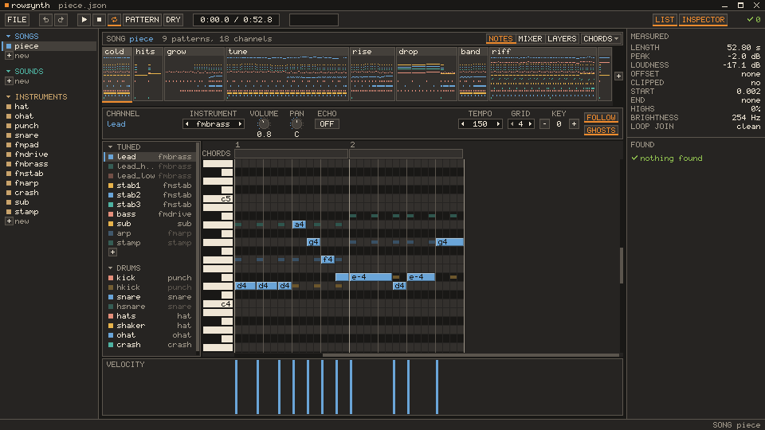

# rowsynth

A chip synth driven by text. A sound effect is a list of notes for an instrument, and a song is a line of text for each of its channels:

```json
"coin": {"def": {"voices": [{"inst": "chime", "notes": [[0, "b5", 4], [4, "e6", 14]]}]}}
```

```json
"lead": "o5 l4 e a >c< a8 b8 | >c< a f a8 g8 | g >c e c8< b8 | b >d< b g"
```

rowsynth reads JSON files of such sounds and songs and computes the audio sample by sample. Its voices are pulse, sawtooth, triangle and noise waves, and FM with four operators. It writes WAV files, measures and checks what it renders, builds layered music for a player to mix, and writes a page to listen on. Through ffmpeg the music can be Opus, and the page MP3 or Opus.

It is made so that a program, or a person who cannot listen while writing, can still work. Every result can be read back as numbers: its level, the pitch at a given time, its brightness, and the jumps at its ends that would click.

It also has a window, `rowsynth gui`: the same files as a piano roll, drum steps, knobs and a mixer, with every change written to the file as it is made.

The example can be heard in a browser: [its six sound effects and its three songs](https://fmihalcioiu.github.io/rowsynth/).

## Running it

rowsynth needs Python 3.10 or newer. In a clone of this repo:

```
pip install .
```

That installs it with NumPy and Numba and adds a `rowsynth` command. In the clone, `python -m rowsynth` is the same command line, and the examples below are written that way.

The first run is slower than the ones after it, because Numba compiles the loops over samples and keeps what it compiled. `ROWSYNTH_NO_JIT=1` in the environment switches the compiling off: the samples come out the same, and a long song takes far longer.

MP3 and Opus files are made by ffmpeg, which has to be on the path. Nothing else needs it.

### Without Python

The releases of this repo have a zip for Windows that needs no Python. Unpacked, it is one folder:

| In the folder | What it is |
|---|---|
| `rowsynth.exe` | The window. A double click opens it on its first screen, and with a project file after its name it opens that file |
| `bin\rowsynth-cli.exe` | The command line. It takes the same words as `python -m rowsynth`, as in `bin\rowsynth-cli.exe check examples\demo.json` |
| `examples` | The example |
| `skill` | The skill that teaches an assistant the command line |

`bin` also holds what the two programs need to run, so the folder is moved whole. Windows asks before it runs a program whose publisher it does not know, as it does here: `More info`, then `Run anyway`.

Everything below is the same with the two programs, `bin\rowsynth-cli.exe` where it says `python -m rowsynth`, and a file can be open in the window while the command line changes it. The first run is slower than the ones after it, as with Python, and MP3 and Opus need ffmpeg on the path.

The folder and the zip are made by `python standalone/build.py`, for the system it is run on. That needs PyInstaller and Pillow, which rowsynth itself does not: `pip install pyinstaller pillow`.

The window, `rowsynth gui`, needs pygame, and nothing else does. In the clone, `pip install ".[gui]"` installs the package with it, and `pip install pygame` adds it to an install that is there. Without it the command stops with `error: the GUI needs pygame, which is not installed: pip install rowsynth[gui]`.

## A first sound

Save this as `ping.json`:

```json
{
  "instruments": {
    "bell": {"wave": "pulse", "vol": [15, 13, 11, 9, 8, 7, 6, 5, 4, 3, 2, 1], "release": 4}
  },
  "sounds": {
    "ping": {"def": {"voices": [{"inst": "bell", "notes": [[0, "e6", 3], [3, "a6", 12]]}]}}
  }
}
```

Time in a sound is counted in ticks, sixty to a second. `bell` is a pulse wave, and its `vol` is the level at each tick of a note, from 15, the loudest, down to 1. `ping` plays two notes on it. A note is `[tick, note, ticks]`: `e6` starts at tick 0 and is held for 3 ticks, then `a6` starts at tick 3 and is held for 12. A note that is let go fades for the `release` of its instrument, 4 ticks here.

```
python -m rowsynth render ping.json ping --out out/ping.wav
```

```
{
  "file": "out/ping.wav",
  "rate": 44100,
  "channels": 1,
  "seconds": 0.35,
  "measure": {
    "seconds": 0.35,
    "peak_db": -3.0,
    "rms_db": -12.3,
    "dc": 0.0,
    "clipped": 0,
    "head_step": 0.0,
    "tail_step": 0.0
  }
}
```

`peak_db` is the loudest sample and `rms_db` the level overall, in decibels against full scale. `dc` is the mean sample, which belongs at zero. `clipped` counts the samples at full scale. `head_step` and `tail_step` are the sizes of the first sample and the last: a sound that starts or ends far from zero clicks.

The peak is -3.0 because `render` brings the loudest sample of a sound to that level. The `db` of a sound moves it from there.

## A first song

Save this as `walk.json`:

```json
{
  "instruments": {
    "lead": {"wave": "pulse", "duty": 1, "vol": [13, 15, 13, 12, 11, 10], "release": 3},
    "bass": {"wave": "tri", "release": 2}
  },
  "songs": {
    "walk": {
      "row_ticks": 6,
      "channels": {
        "lead": {"inst": "lead", "pan": 0.3},
        "bass": {"inst": "bass", "gain": 0.8, "pan": -0.3}
      },
      "patterns": {
        "a": {
          "lead": "o4 l8 c d e f g4 g4 | a a a a g2",
          "bass": "o2 l4 c c e e | f f c2"
        }
      },
      "order": ["a"]
    }
  }
}
```

A song has channels, and each channel plays one instrument. A pattern holds a line of text for each channel, and `order` lists the patterns to play in turn. Time in a song is counted in rows. `row_ticks` is the ticks a row lasts, and there are four rows to a beat unless `rows_per_beat` says otherwise. Here a beat is 24 ticks, which is 150 beats a minute.

In the lead's text, `o4` sets the octave and `l8` makes every note written without a length an eighth note. `c d e f` are four of those, `g4` is a quarter note and `g2` a half note. The bar line changes nothing. Each channel comes to 32 rows, two bars of 16.

```
python -m rowsynth render walk.json walk --out out/walk.wav
```

The file is stereo and 3.7 seconds long: 3.2 seconds of rows, and half a second for what is still sounding after the last of them.

A channel's text is made of the following, and anything else in it is refused.

| Text | What it does |
|---|---|
| `c` `d` `e` `f` `g` `a` `b` | A note, in the octave the text has reached |
| `c+` `c#` `c-` | A sharp, written either way, and a flat |
| `c1` `c2` `c4` `c8` `c16` | A length: a whole note, a half, a quarter, an eighth, a sixteenth. `c4` is one beat, and `c12` is a third of one |
| `c4.` `c4..` | A dot adds half the length, and a second dot a quarter of it |
| `r` `r4` `r8.` | A rest, timed as a note is |
| `l8` | The length of whatever is written without one, from here on. It starts at 16 |
| `o4` | The octave, 0 to 9. It starts at 4, where `c` is middle C |
| `>` `<` | An octave up, an octave down. They go past what `o` can write, as far as a note can be: -97 to 136 as a number, where middle C is 60 |
| `&` | A tie: `c4 & c8` is one note as long as the two |
| `v12` | The volume from here on, 0 to 15. It starts at 15 |
| `@name` | The instrument from here on, in place of the channel's |
| `k` `s` `h` `H` `t` | A drum hit, in a drum channel only. It is timed as a note is: `k8`, `H4.` |
| `\|` | A bar line, which changes nothing |

Spaces only keep things apart. Every pattern starts its channels again at octave 4, a length of 16, full volume and the channel's own instrument.

## The project file

A project file is JSON with up to four tables: `instruments`, `chords`, `sounds` and `songs`. Each is a set of named entries, and any of them can be left out. `examples/demo.json` has six sound effects and three songs: `tune`, a short layered tune with chords, `korobeiniki`, a folk tune for six channels, and `piece`, a longer piece for eighteen channels that plays instruments of its own.

Loading refuses a key it does not know and a value of the wrong kind. It also refuses a name that points at nothing, such as a channel whose instrument is not in the file. The message gives the place. With `vol` misspelt as `volume` in `ping.json`, a command on the file prints this to standard error and exits with code 2:

```
error: instruments.bell: unknown key 'volume'
```

Sounds, songs, channels, groups and versions give their names to files, so those names cannot hold any of `/ \ : * ? " < > |`.

### Instruments

An instrument is a wave and what is done to it over the ticks of a note. Every key can be left out.

| Key | What it does | Default |
|---|---|---|
| `wave` | `pulse`, `saw`, `tri`, `noise` or `fm` | `pulse` |
| `vol` | The level, from 0 to 15. A step table | 15 |
| `duty` | The width of a pulse: 0, 1, 2 and 3 are 12.5%, 25%, 50% and 75%. A step table | 2 |
| `arp` | Semitones above the note. A step table | 0 |
| `pitch` | Semitones the note moves by at each tick and keeps: a sweep. A step table | 0 |
| `vib` | Vibrato: `{"delay": ticks, "depth": semitones, "rate": Hz}`. `depth` is needed. Left out, `delay` is 0 and `rate` is 6 | none |
| `slide` | Semitones a second the note moves by for as long as it sounds | 0 |
| `release` | Ticks a note fades for once it is let go | 2 |
| `gain` | A factor on the level | 1 |
| `short` | `true` gives noise its short register, a buzz with a pitch to it | `false` |
| `lp` | The cutoff of a low-pass in Hz. 0 is no low-pass. A step table | 0 |
| `res` | The resonance of the low-pass, from 0 to 0.98 | none |
| `key_scale` | Decibels added to the level for each octave above middle C, and taken off for each octave below | 0 |
| `gate` | The share of its rows a note of a song is held for | 0.9 |
| `alg` | The FM algorithm, 0 to 7 | 4 |
| `fb` | FM feedback: how far operator 0 bends its own phase, in radians | 0 |
| `ops` | The FM operators, four at most | none |

A step table is read once a tick, counted from the start of the note. A number holds for the whole note. A list gives one value a tick, and its last value holds from there on. `{"v": [0, -1], "loop": 1}` is a list that goes round again from index `loop` when it runs out.

`pulse` and `saw` have their edges smoothed. `tri` is a triangle in 16 levels. `noise` is the low bit of a 15-bit shift register, and its note sets how often the register is clocked: 4000 times a second at `a4`, doubling every six semitones.

Where `arp`, `pitch`, `vib` or `slide` carry a note lower or higher than a note can be, which is -97 and 136, it sounds at that end.

An `fm` instrument has four operators, numbered from 0. Each is a sine under an envelope of its own, and `alg` says which operators bend the phase of which, and which are heard:

| `alg` | Wiring |
|---|---|
| 0 | 0 bends 1, 1 bends 2, 2 bends 3. Only 3 is heard |
| 1 | 0 and 1 bend 2, 2 bends 3. Only 3 is heard |
| 2 | 1 bends 2, 0 and 2 bend 3. Only 3 is heard |
| 3 | 0 bends 1, 1 and 2 bend 3. Only 3 is heard |
| 4 | 0 bends 1, and 2 bends 3. 1 and 3 are heard |
| 5 | 0 bends 1, 2 and 3, and all of those are heard |
| 6 | 0 bends 1. 1, 2 and 3 are heard |
| 7 | Nothing is bent. All four are heard |

An operator has four keys:

| Key | What it does | Default |
|---|---|---|
| `mul` | Its frequency, as a multiple of the note's | 1 |
| `det` | Hz added to that frequency | 0 |
| `level` | Its amplitude when it is heard, and radians of bend when it is not | 1 |
| `env` | Its envelope, `{"a", "d", "s", "sd", "r"}`: seconds of attack, seconds of decay down to the level `s` from 0 to 1, decibels a second lost while the note is held, and seconds of release to 60 dB down | `a` 0, `d` 0.3, `s` 1, `sd` 0, `r` 0.2 |

Operators left out of `ops` are silent. The other keys of the instrument, `vol` and `lp` among them, work on an FM voice as on any wave. This is the bass of the song `piece` in `examples/demo.json`:

```json
"fmdrive": {
  "wave": "fm",
  "alg": 4,
  "fb": 0.45,
  "ops": [
    {"mul": 1, "level": 2.4, "env": {"a": 0, "d": 0.1, "s": 0.35, "sd": 4, "r": 0.05}},
    {"mul": 1, "level": 0.9, "env": {"a": 0, "d": 0.3, "s": 0.7, "r": 0.06}},
    {"mul": 2, "level": 0.6, "env": {"a": 0, "d": 0.04, "s": 0.05, "r": 0.04}},
    {"mul": 1, "level": 0.6, "env": {"a": 0, "d": 0.3, "s": 0.7, "r": 0.06}}
  ],
  "vol": [15],
  "release": 3,
  "gate": 0.7,
  "lp": 1600
}
```

### Sounds

A sound is voices playing notes. A voice has `inst`, an instrument by name or written out in place, and `notes`:

```json
"powerup": {
  "def": {
    "voices": [
      {
        "inst": "chime",
        "notes": [[0, "c5", 4], [4, "e5", 4], [8, "g5", 4], [12, "c6", 4], [16, "e6", 4], [20, "g6", 12]]
      }
    ],
    "echo": {"time": 0.09, "feedback": 0.35, "mix": 0.3, "lp": 4000}
  }
}
```

A note is `[tick, note, ticks]` or `[tick, note, ticks, velocity]`: the tick it starts at, what it is, the ticks it is held for, and a factor on its level. The note is a name such as `c#4` or `eb3`, with middle C at `c4`, or a number, with 69 for `a4`. A flat is `b` here and `-` in song text. A number is from -97 to 136: -97 is `cb-9`, the lowest note a name can say, and 136 is the last note under half of 44100 samples a second. A note lower or higher is refused wherever it is written: in a sound, in a `check`, as the `note` of a drum, and in a song's text.

`echo` brings the sound back `time` seconds after itself, and again that much later at `feedback` of the level before, each return darker through a low-pass at `lp` Hz. `mix` is the level of the first return. Only `time` is needed. A list of times gives a delay line for each, and the lines share the `mix`. Left out, `feedback` and `mix` are 0.3 and `lp` is 3000.

An entry of `sounds` holds one of four keys, and only one:

| Key | The entry is |
|---|---|
| `def` | One sound |
| `defs` | Variants: a list of sounds under one name |
| `parts` | Sounds on a timeline, `[[seconds, entry], ...]`, added up into one. Each part is an entry with a `def` |
| `held` | A sound that goes on for as long as it is held: a start, a loop and an end |

In `examples/demo.json`, `coin` is one sound, `blip` is three variants and `explosion` is two parts. An entry can also hold these:

| Key | What it does | Default |
|---|---|---|
| `db` | The level of the sound, in decibels from the peak every sound is brought to. With `defs` it can be a list, one level a variant. An entry of `parts` has none, and each part has its own | 0 |
| `meta` | Data of your own. `render_bank` hands it back as it is | `{}` |
| `check` | Notes for the `pitch` rule to read back: `[{"at": seconds, "note": "e6"}]` | none |
| `max_seconds` | The longest the sound may last, for the `length` rule | none |
| `max_dc` | The limit of the `dc` rule for this sound | 0.002 |
| `max_bright` | The limit of the `bright` rule for this sound | 0.3 |

The commands level every sound the same way. It is rendered at a gain of 0.12, which is meant to keep it under the level where the output stage bends a sound. Its loudest sample is then brought to 3 dB under full scale and moved by its `db`. A sound may have a `gain` beside its `voices`, 0.5 when left out, and only `render_sound` in Python goes by it.

A held sound, added to the sounds of `examples/demo.json`:

```json
"hum": {
  "held": {
    "note": {"voices": [{"inst": "bass", "notes": [[0, "c3", 60]]}]},
    "start": 6,
    "loop": 30,
    "join": 3,
    "end": {"voices": [{"inst": "bass", "notes": [[0, "c3", 2]]}]},
    "let_go": 4
  },
  "db": -6
}
```

`note` is rendered once. Its first `start` ticks are the start, which is played once. The `loop` ticks after them are the loop, which goes round for as long as the sound is held. The last `join` ticks of the loop are faded into the ticks before the loop began, so that it comes round without a click. `end` is a sound of its own, played when the held one is let go. `let_go` is the ticks the letting go takes, handed on to whoever plays the sound. All six keys are needed.

### Songs

A song plays patterns of text on its channels, in the order it lists.

| Key | What it holds | Default |
|---|---|---|
| `row_ticks` | The ticks a row lasts | needed |
| `rows_per_beat` | The rows in a beat. A bar is four beats | 4 |
| `gain` | The level of the whole mix | 0.35 |
| `channels` | The channels by name | needed |
| `patterns` | The patterns by name: a line of song text for each channel that plays in the pattern | needed |
| `order` | The patterns to play, in turn | needed |
| `drums` | What each drum letter plays | none |
| `instruments` | Instruments of the song's own: each an instrument, or the name of one of the project's. They are laid over the project's | none |
| `chords` | The chords of a pattern, bar by bar, for the `chords` rule | none |
| `layers` | Groups, versions and keys, under Layered music below | none |
| `intro` | Patterns played once before the song goes round | none |

A pattern lasts as long as the longest of its channels, and a channel it has no text for is silent in it. A channel has these keys:

| Key | What it does | Default |
|---|---|---|
| `inst` | The instrument its notes play | needed |
| `gain` | Its level in the mix | 1 |
| `pan` | -1 is all left and 1 all right. At 0 each side has it 3 dB down | 0 |
| `drums` | `true` makes it a drum channel: it reads the drum letters, and it plays the same in every key | `false` |
| `echo` | `{"rows", "gain"}`: every note is played a second time, `rows` later and at `gain` of its level | none |

`drums` maps any of the letters `k`, `s`, `h`, `H` and `t` to what it plays:

```json
"drums": {
  "k": {"inst": "kick", "note": "c3", "rows": 2},
  "s": {"inst": "snare", "note": "c5", "rows": 2},
  "h": {"inst": "hat", "note": "c7", "rows": 1}
}
```

`inst` and `note` are needed. `rows` is the most rows a hit is held for, and `vel` is a factor on its level, 1 when left out.

A chord in the project's `chords` table is the pitch class of its root and the pitch classes that belong to it, counted from 0 for c to 11 for b. A song's `chords` then has one string for each bar of a pattern. A string that names several chords, with spaces between them, gives each an even share of the bar.

```json
"chords": {
  "Am": {"root": 9, "tones": [9, 0, 4]},
  "F": {"root": 5, "tones": [5, 9, 0]}
}
```

```json
"chords": {
  "a": ["Am", "F", "C", "G"],
  "b": ["F", "G", "Am", "Am"]
}
```

`intro` is `{"order", "tail", "fade"}`. The patterns of its `order` are played once. The intro runs on for `tail` seconds past them, 1.5 when left out, for what is still sounding, and falls away to nothing over its last `fade` seconds, 0.05 when left out. The tail cannot be longer than one bar. `build` writes the intro as a file of its own, and the listen page has a player for it.

## The window

```
python -m rowsynth gui examples/demo.json
```



The window shows a project file as something to click on. Notes are placed with the mouse and heard as they are placed, and every change is written to the file as it is made. It works on the same files as the commands, and the two can work on one file at the same time.

It is drawn for 960 by 540 pixels, and each drawn pixel is shown as a square of screen pixels. How big that square is, is settled as the window opens: the largest at which the screen still has room for the whole layout. It stays that for as long as the window is open, so a smaller window shows less and nothing in it gets smaller. The window is never smaller than 640 by 400 drawn pixels.

The window has a title row of its own in place of the system's: the name of the file, and buttons to minimise, to maximise and to close. A drag on the row moves the window, a double press on it maximises, and the edges and corners resize. On Windows it is the system that does all of this, so the window snaps to the sides of the screen and answers the keys of the system as any other does. Where none of it can be set up, the window opens with the frame of the system.

### The parts of the screen

| Part | What it is for |
|---|---|
| Top bar | `FILE`, undo and redo, play, stop and loop, `PATTERN` to play only the pattern that is shown, `DRY` to play without echoes, the time, a meter, `LIST` and `INSPECTOR` to show or hide the two side panels, and at the right end how many findings `check` has for the project |
| The list on the left | The songs, the sounds and the instruments. A click picks one, and Space plays what is picked. After the last of each kind stands a `+` that makes a new one. The `+` of the instruments offers `Empty`, `Empty in this song` for an instrument that only the picked song has, and a few ready instruments to start from |
| The middle | What is picked, to change: a song, an instrument or a sound, each as below |
| The inspector on the right | `MEASURED` has the numbers of what is picked, the ones `measure` prints, in words, and one that breaks a rule is red. `FOUND` has the findings of `check`, those of the picked thing first. A click on a finding goes to the thing it is in. A finding with one sure repair has a `FIX` button, and `FIX ALL` makes all of them as one step |
| Status line | One line for whatever the mouse is on: what a press does there, what a right press does, and what the wheel does. At its right end is what is picked |

The borders between the list, the middle and the inspector are dragged to give one of them more room.

A window too narrow for all three has no inspector, and a narrower one has no list either, so the editor in the middle keeps its room. Half of a wide screen is such a window. `LIST` and `INSPECTOR` in the top bar bring a panel back there, and take one off a wide window to give the editor more room. Both panels come back by themselves when the window is wide enough again.

The three editors of the middle are laid out alike. At the top is a heading with the name of the thing and the buttons that act on all of it. Under it is one bar with the knobs of what is picked inside. Then comes the main area with a column of names at its side, and at the foot what comes out of it: the velocity of the notes, the wave, or the scope.

After every change the picked thing is rendered again and the checks are run again, so the numbers and the findings are those of the file as it is. Nothing plays by itself: a pick or a change is silent, and a note that is placed is heard alone.

### The mouse and the wheel

They do the same in every view.

| Where | Press | Right press |
|---|---|---|
| An empty place on a grid of notes, drum steps or a step table | puts a note, a hit or a value there; a drag draws along | |
| A note, a hit, a step | picks it; a drag moves it, and by its right end makes it longer or shorter | rubs it out |
| A thing with a name: a row of a list, a block, a tab, a channel, a drum, a group, a version, a chord | picks it; twice renames it, where its name can be changed | opens its menu: `Rename...`, `Copy`, what is special to it, `Remove` |
| A knob or a fader | a drag turns it, a tenth as fast with Shift | puts it back to its usual value |
| A button with a small arrow | opens its list | |

Shift and a drag on a grid draw a box that picks notes, and Ctrl and a press add a note to the picked ones.

The wheel goes up and down over a grid or a list: along the keys, the lanes or the rows. With Shift it goes sideways, along the time. With Ctrl it zooms the time. A view that only goes one way, as the song strip and the mixer do, goes that way with the wheel alone. Over a knob, a fader or a stepper the wheel changes its value, and nowhere else does it change one. A view that scrolls has a thin bar on the side it scrolls along, which can be dragged.

Wherever there can be one more of something, a `+` stands after the last one.

### Songs

The heading has `NOTES`, `MIXER` and `LAYERS`, which choose what the main area shows, and `CHORDS`, which lists the chords of the project: a `+` makes one from a root and a kind, and the menu of a chord renames it, changes it or removes it.

Under the heading is the song as a strip of blocks, one for each pattern in its `order`, with the notes drawn small. A click on a block shows that pattern. A block is dragged to another place in the order, and with Ctrl held it is copied there as a new pattern. The menu of a block plays its pattern again after it, copies it, puts an empty pattern after it, renames it, sets its length in bars, or takes the block out of the order.

The bar has the picked channel's `INSTRUMENT`, `VOLUME`, `PAN` and `ECHO` with its `TIME` and `AMOUNT`. At its right end are `TEMPO`, `GRID` and `KEY`. `TEMPO` steps through the tempos a song can have: a row lasts a whole number of ticks, so at four rows to a beat they are 900 over that number. `GRID` is the rows of a beat, and offers only the grids at which the song sounds the same and every note stays on a row. The two buttons of `KEY` move every tuned note a semitone down or up.

`NOTES` has the channels at the side, the tuned ones and the drum channels apart, and beside them the picked channel in the picked pattern.

- A tuned channel is a piano roll. A channel plays one note at a time, so a note placed where another still sounds cuts that one short. A note that is placed ends where the next one begins, so a press in the wrong place takes no note away. Under the grid is the velocity of each note as a bar to drag. Over it a strip names the chord of each bar, and the keys of that chord are lit across the bar; a click on a bar picks its chord. A note that the `chords` rule would find is outlined in red, also while it is dragged. `GHOSTS` draws the notes of the other channels dim behind, and `FOLLOW` has the pattern that is shown go along with the playing.
- A drum channel is a grid of steps: a lane for each drum with its name at the side, and a square for each row, with all the drum channels of the pattern together. A press on an empty square puts a hit, and a drag puts one in each empty square along the lane. A press on a hit picks it, a drag moves the picked hits along their lanes, and a right press rubs a hit out. A hit that is let go on a square its channel plays already takes the place of what was there. The keys do to the picked hits what they do to picked notes: Left and Right move them a square, Up and Down move them to the lane above or below where that is a drum of the same channel, and Ctrl+A picks the hits of the lane pressed in last, or with Shift every hit of the pattern. The velocity lane has the hits of the lane pressed in last. The `+` under the last lane adds a drum to the song under a letter, and the menu of a lane sets its `Instrument`, its `Note...`, its `Length...` and its `Velocity...`.
- The menu of a channel also moves it up or down and makes a tuned channel a drum channel or back, while it has no notes.

The grid is the rows. A pattern with a note that starts or ends between two rows, as a triplet does at four rows to a beat, is shown and is not changed here.

`MIXER` has every channel side by side: a fader for its volume and a meter each, `M` to mute it and `S` to solo it, and a fader for the whole song. A mute or a solo is a way of listening. It is not written to the file, and it is not a step that is taken back.

`LAYERS` has the groups of the song against its versions as a table of switches, a button on each version to hear it alone, the keys, and the intro with its patterns, its tail and its fade. A press on the field of the keys opens a list to hear the song in one of them or to remove one. The menu of a version also has it premixed in a key.

### Instruments

The heading has the wave as a row of buttons. The bar has every knob of the instrument: `VOLUME`, `RELEASE`, `GATE`, `SLIDE`, the vibrato's `DEPTH`, `DELAY` and `RATE`, `RESONANCE`, `KEY TRACKING` and the switch `SHORT NOISE`. A knob is dragged up and down, a tenth as fast with Shift held, or turned with the wheel, and a right press puts it back to what the engine takes when the file has no value.

The main area has the step tables as bars, each beside its name: `VOLUME SHAPE`, `PULSE WIDTH`, `ARPEGGIO`, `PITCH` and `CUTOFF`. A table is drawn with the mouse: a press or a drag sets every step it passes, a right press puts a step back to zero, the handle after the last bar makes the table longer or shorter, and the bracket under the bars is its loop.

With the FM wave the main area has the eight wirings as pictures to click, and under them the four operators, each with `RATIO`, `DETUNE`, `VOLUME` and its envelope as a line with points to drag. The bar then has `FEEDBACK` as well.

At the foot is a keyboard of two octaves to try the instrument on. Beside it a scope shows a few cycles of the note played last, and a spectrum where its energy sits from low to high. The spectrum has a line at 4 kHz and the share of the energy above it, which is what the `bright` rule goes by.

A song's own instruments stand in the list after the project's, each with the name of its song beside it, and are changed in the same way. `Empty in this song` under the `+` makes a new one, the menu of a project's instrument copies it into the song as its own, and the menu of an own one renames it, removes it or makes it shared, which moves it to the instruments of the project.

### Sounds

A sound is laid out as a channel of a song is: a keyboard and a grid, here on a clock of seconds, with the velocity of the notes and the wave of the sound at the foot on the same clock. Notes are placed, moved, stretched and rubbed out as in the piano roll, on a grid of ticks, and the keyboard scrolls and zooms as it does there. With the mouse on the wave, the status line says the pitch that is heard at that moment.

The clock goes on after the end of the sound, by as long again as the sound and by no less than a second. A note that is put there, or made longer into it, makes the sound longer, and the room is then after its new end. A sound opens with its whole length and a little of that room in view. Shift and the wheel, or the bar under the notes, go along the rest, and Ctrl and the wheel zoom out until all of it is in view. The zoom stays as it was set while the sound gets longer or shorter.

The bar has the voices as tabs with a `+` after the last, then the `INSTRUMENT` of the picked voice, the `VOLUME` of the sound, and its `ECHO` with `TIME`, `AMOUNT`, `REPEATS` and `TONE`. Each return of the echo is drawn as a fainter copy of the notes, as much later as it is heard. A voice whose instrument is written in place in the file shows `its own`, and the list beside it has `Make shared...`, which gives the instrument a name among the project's.

The heading has four buttons.

- The first reads `SINGLE`, `VARIANTS`, `PARTS` or `HELD`: the kind of the sound. Its list makes the sound another kind, and each item says what the sound would lose by it. Variants lie one after the other on the clock. A part has a numbered tab on the ruler, which is dragged to move where the part starts, and the `+` after the last one adds a part or a variant. The menu of a variant plays it, moves it a place or removes it, and the menu of a part copies it, sets its level or removes it.
- `LIMITS` has what the checks hold the sound to: how long it may last, how far off zero and how bright it may be. The longest time is also a red line on the clock, set from the menu of the ruler and dragged from there.
- `NOTES` has the remarks the file keeps with the sound, each a name and a text.
- `HOLD` is there for a held sound, which has its start, its loop and its end as three tinted zones with borders to drag: the sound is held for as long as the button is kept pressed, and its end is heard when the button is let go. The bar then has `CROSSFADE` and `RELEASE` for its loop.

The menu of the ruler also has `Expect a note here...`. It puts a flag on the ruler for a note the sound should play at that moment, which the checks then hold it to.

### The FILE menu

| Item | What it does |
|---|---|
| `New project...` | Asks for a file that is not there yet and puts the smallest project that can be heard in it: one instrument, one sound and one song |
| `Open...` | Opens another project file in the window |
| `Save a copy as...` | Writes the project as it is to another file. The open file stays the open one |
| `Export...` | Opens a window with three tabs, for what `render`, `build` and `page` do: the picked sound or song as a WAV file (one variant of a sound, or one part of a held sound, where it has them), the songs for a player, or the listen page. It lists the files it will write, with their sizes where those are known and a mark on each that takes the place of a file that is there, and writes none of them until `WRITE` is pressed |
| `Measure a WAV file...` | Asks for a WAV file and shows its numbers, the ones `measure` prints for it |
| The files opened last | Eight at the most, each opened with a click. One that is no longer there is dim |
| `Close` | Closes the project and shows the first screen |

There is no Save, because nothing is ever left unsaved.

The first screen is also what `python -m rowsynth gui` shows with no file. It has `NEW PROJECT`, `OPEN...`, the files opened last, and in a clone of this repo the example. It is opened as a copy in a file you name, so the example itself is never changed.

### Every change is saved, and can be taken back

A note that is placed, a knob that is let go of, a pattern that is moved: each is written to the file as it is made, in the layout that `set` writes, under Commands below. A change the project cannot hold is refused. The file is then as it was, and the status line says why.

Each change is also a step. Ctrl+Z takes the last step back and Ctrl+Y makes it again, as the two arrows in the top bar do, and both write the file. With the mouse on an arrow the status line says which step it is. The last 200 steps are kept, for as long as the file stays open in the window.

### Another program on the same file

The window looks at its file four times a second. When another program has written it, `rowsynth set` or an editor, the window reads it again and shows what it holds now. A song that is playing goes on from where it is, with the change in it. The status line names what changed, as in `changed outside: tune`, the thing glows in the list for a moment, and the change is a step like any other: Ctrl+Z takes it back, in the file as well.

The window and the other program can both write between two looks. Changes to different places are both kept: what the other program changed is named and glows as above, and it is a step of its own under the window's, so Ctrl+Z takes the window's change back first. Where both changed the same place, such as one channel of one pattern, the change made in the window is the one that stands. The status line says that it `was changed outside at the same moment: this change stands, and undo brings the other back`, and Ctrl+Z then puts in the file what the other program wrote.

A file that cannot be read just then, half written or no JSON, changes nothing in the window. The status line says what is wrong with it, a change made in the window is refused meanwhile, and the file is taken in when a later look finds it whole.

### Keys

| Key | What it does |
|---|---|
| Space | Plays what is picked, or stops what plays |
| Ctrl+Z | Takes the last step back |
| Ctrl+Y, Ctrl+Shift+Z | Makes the step again |
| Delete, Backspace | Removes the picked notes |
| Up, Down | Moves the picked notes a semitone, and with Shift an octave |
| Left, Right | Moves the picked notes a step of the grid |
| Ctrl+A | Picks every note. In a sound it is every note of the picked voice, and with Shift of every voice |
| Ctrl+C, Ctrl+V | Copies the picked notes, and pastes them where the mouse is |
| Escape | Drops what the mouse is in the middle of, or else what is picked. Closes a menu or a box |
| Enter | Takes what is typed in a box, and the lit row of a menu |
| `Z S X D C V G B H N J M` | The twelve notes from c, as on a piano. `Q 2 W 3 E R 5 T 6 Y 7 U` are the octave above, and `I 9 O 0 P` go on from there |

The keys that change notes go to the piano roll or to the notes of a sound, whichever was clicked in last. The piano keys play the channel of the piano roll, the picked voice of a sound, or the instrument that is shown, once it has been clicked in. In a list, Up, Down, Home and End move the pick.

## Commands

Every command prints one JSON document to standard output, so a script can read the result. A command that cannot go on prints `error:` and the reason to standard error and exits with code 2. `python -m rowsynth COMMAND -h` lists everything a command takes.

Paths are shown here as they were typed. On Windows the two paths a command puts together itself, `manifest` and `page`, are printed with backslashes.

### info

```
usage: rowsynth info [-h] FILE
```

What a project file holds, by name, and how long each song runs.

```
python -m rowsynth info examples/demo.json
```

```
{
  "instruments": [
    "chime",
    "hop",
...
  ],
  "sounds": {
    "coin": {
      "kind": "sound"
    },
...
    "blip": {
      "kind": "variants",
      "variants": 3
    },
    "powerup": {
      "kind": "sound"
    }
  },
  "songs": {
    "tune": {
      "channels": [
        "lead",
        "arp",
        "bass",
        "kit"
      ],
      "patterns": [
        "a",
        "b"
      ],
      "order": [
        "a",
        "b"
      ],
      "rows": 128.0,
      "seconds": 12.8,
      "layers": {
...
      }
    },
...
  },
  "chords": [
    "Am",
    "F",
    "C",
    "G"
  ]
}
```

The output is cut at each line of `...`: ten more instruments, three more sounds, what the layers of the tune hold, and the two other songs.

### render

```
usage: rowsynth render [-h] --out PATH [--rate N] [--variant N]
                       [--part {start,loop,end}] [--stems]
                       FILE NAME
```

Writes a sound as a mono WAV file, or a song as a stereo one, at 16 bits a sample, and prints its numbers.

```
python -m rowsynth render examples/demo.json coin --out out/coin.wav
```

```
{
  "file": "out/coin.wav",
  "rate": 44100,
  "channels": 1,
  "seconds": 0.38333333333333336,
  "measure": {
    "seconds": 0.383,
    "peak_db": -3.0,
    "rms_db": -11.3,
    "dc": 0.0,
    "clipped": 0,
    "head_step": 0.0,
    "tail_step": 0.0
  }
}
```

`--variant 2` writes the third variant of a sound, and `--part loop` the loop of a held sound. With `--stems` a song is written as one mono loop a channel, each `CHANNEL.wav` in the folder that `--out` names.

### measure

```
usage: rowsynth measure [-h] WAV [--at SECONDS]
       rowsynth measure [-h] FILE NAME [--rate N] [--variant N] [--part {start,loop,end}] [--at SECONDS]
```

The numbers of a sound or a song of a project file, with nothing written. With a WAV file alone, the numbers of that file.

```
python -m rowsynth measure examples/demo.json coin --at 0.15
```

```
{
  "name": "coin",
  "kind": "sound",
  "rate": 44100,
  "channels": 1,
  "seconds": 0.38333333333333336,
  "measure": {
...
  },
  "brightness": {
    "centroid_hz": 1846,
    "above_4k": 0.06
  },
  "pitch": {
    "at": 0.15,
    "hz": 1319.2
  }
}
```

The cut holds the seven numbers that `render` printed above. `brightness` says where the energy sits: its centre in Hz, and the share of it above 4 kHz. `pitch` is there when `--at` asks for it: the note sounding at that time in Hz. It is 0.0 when there is no note to read: in silence, in noise, and wherever else the wave does not repeat. The note is read from the 0.04 seconds that follow, and is still read when the next note begins in the second half of them. The second note of the coin is `e6`, which is 1318.5 Hz.

### check

```
usage: rowsynth check [-h] [--rate N] FILE
```

Holds a project file to the rules under Checks below and prints what breaks them. The exit code is 1 when anything does and 0 when nothing does.

```
python -m rowsynth check examples/demo.json
```

```
{
  "findings": []
}
```

### build

```
usage: rowsynth build [-h] --out DIR [--rate N] [--format {wav,opus}]
                      FILE [NAME ...]
```

Writes songs into a folder as the files a player loads, with a manifest, `music.json`, that names them. With no `NAME` it builds every song of the project, and the rate is 48000 unless `--rate` gives another.

```
python -m rowsynth build examples/demo.json piece --out out/music
```

```
{
  "folder": "out/music",
  "manifest": "out/music/music.json",
  "rate": 48000,
  "format": "wav",
  "songs": {
    "piece": {
      "loop_samples": 2534400,
      "gain": 0.891194,
      "source": "c133f9bc2378f128",
      "file": "piece.wav"
    }
  }
}
```

A song without layers is one stereo loop, `NAME.wav`, with its loudest sample 1 dB under full scale. The loop is made to go round: what the song is still sounding when its rows end is added on at the start. `loop_samples` is its length. `gain` is what a player multiplies the samples by to have the song at its own level again. `source` is 16 hex digits made from the song, the rate and the version of rowsynth, and other digits in an older manifest mean its files are out of date. The manifest holds the `rate`, the `format` and the `songs` printed here.

With `--format opus` the files are Opus and end in `.opus`, in the folder as in the manifest. Opus takes a rate of 8000, 12000, 16000, 24000 or 48000, and any other is refused. A build has no MP3: an MP3 file has silence added at its ends, and a loop of one cannot go round without a gap.

A song with an `intro` has one more file, `NAME.intro.wav`, to be played once before the loop. It is multiplied by the same factor as the loop, so the two are at one level, and the entry of the song ends with `intro`. With `"intro": {"order": ["a"]}` added to the song in `walk.json`:

```
python -m rowsynth build walk.json --out out/walk
```

```
{
  "folder": "out/walk",
  "manifest": "out/walk/music.json",
  "rate": 48000,
  "format": "wav",
  "songs": {
    "walk": {
      "loop_samples": 153600,
      "gain": 0.782657,
      "source": "c45def5719929ca1",
      "file": "walk.wav",
      "intro": {
        "file": "walk.intro.wav",
        "in_samples": 225600,
        "walk_samples": 153600
      }
    }
  }
}
```

`in_samples` is the length of the intro's file. `walk_samples` is the sample of it at which the loop is to begin, and the 1.5 seconds after that are the tail.

### page

```
usage: rowsynth page [-h] --out DIR [--rate N] [--format {wav,mp3,opus}] FILE
```

Writes the listen page of a project into a folder, with its audio as WAV unless `--format` asks for MP3 or Opus.

```
python -m rowsynth page examples/demo.json --out out/demo
```

```
{
  "page": "out/demo/index.html",
  "folder": "out/demo",
  "rate": 48000,
  "format": "wav",
  "sounds": 6,
  "songs": 3,
  "files": 19
}
```

### set

```
usage: rowsynth set [-h] [--text] [--from PATH] [--delete] FILE WHERE [VALUE]
```

Changes one thing in a project file and keeps the rest of it as it is. It is how a script changes a project, and how anything changes a file that the window has open, without writing the whole file back.

`WHERE` is the place, written as `check` writes a target: names joined by dots, and `[n]` after a list for its item n, counted from 0. The examples are run on `tune.json`, a copy of `examples/demo.json`.

```
python -m rowsynth set tune.json songs.tune.channels.bass.gain 0.7
```

```
{
  "file": "tune.json",
  "where": "songs.tune.channels.bass.gain",
  "was": 0.9,
  "now": 0.7
}
```

`VALUE` is read as JSON when it is JSON, and as text when it is not. So `0.7` is a number, and the text of a channel is text. `--text` takes the value as text whatever it looks like: without it `2` is a number, and with it the name of a pattern that is called 2.

```
python -m rowsynth set tune.json songs.tune.patterns.b.lead "o5 l4 a >c f c< | b >d g d< | >e2 c4< a4 | a2 r2" --text
```

```
{
  "file": "tune.json",
  "where": "songs.tune.patterns.b.lead",
  "was": "o5 l4 a >c f c< | b >d g d< | >e2 c4< a4 | a1",
  "now": "o5 l4 a >c f c< | b >d g d< | >e2 c4< a4 | a2 r2"
}
```

`--from PATH` reads the value from a file, and from standard input when the path is `-`. The line end the file closes with is no part of the value. With `l8 k h s h k k s h | l8 k h s h k k s h | l8 k h s h k k s h | l8 k h k h k s l16 s s s s` saved as `kit.txt`:

```
python -m rowsynth set tune.json songs.tune.patterns.a.kit --from kit.txt
```

```
{
  "file": "tune.json",
  "where": "songs.tune.patterns.a.kit",
  "was": "l8 k h s h k k s h | l8 k h s h k k s h | l8 k h s h k k s h | l8 k h s h k k s h",
  "now": "l8 k h s h k k s h | l8 k h s h k k s h | l8 k h s h k k s h | l8 k h k h k s l16 s s s s"
}
```

`--delete` takes out what is at the place, and has no value:

```
python -m rowsynth set tune.json songs.tune.channels.lead.echo --delete
```

```
{
  "file": "tune.json",
  "where": "songs.tune.channels.lead.echo",
  "was": {
    "rows": 3,
    "gain": 0.3
  }
}
```

A key that is not there yet is added, and so is the next item of a list: `was` is then left out. A value that is what the file holds already is not written, and the answer has `"same": true`.

The file is read, changed, checked and written in the one run, so what another program wrote to it a moment before is kept. The check is the one that loading makes: an unknown key, a value of the wrong kind, a name that points at nothing. A change that fails it is refused with the reason and exit code 2, and the file is as it was:

```
python -m rowsynth set tune.json songs.tune.channels.bass.inst organ
```

```
error: songs.tune.channels.bass.inst: no instrument named 'organ'
```

`set` also reads the text of every song it changed, which loading does not. A line that cannot be read is refused in the same way, and so is a note that no instrument can play:

```
python -m rowsynth set tune.json songs.tune.patterns.a.lead "o5 zz"
```

```
error: songs.tune: pattern 'a', channel 'lead': cannot read "zz" in a channel
```

A song that could not be read before the change can still be changed, so a file with several faults is mended one at a time. `set` runs none of the rules: a line that is a bar short is written, and `check` reports it under `rows`.

`set` writes the file in one layout, the one the window saves in and the example is kept in. Each entry of the four tables starts a line. A song is opened out, and so are its `instruments`, `drums`, `channels`, `patterns` and `layers`, one entry a line, and each pattern, one channel's text a line. Anything else is on one line when it ends by column 110, and is opened out one key or item a line when it does not. A text is never broken, and keys keep their order. So a change to one channel of one pattern changes one line of the file, and each of the four changes above is one line in a diff. A file that was in another layout is put into this one by the first change. The text goes to a temporary file that takes the place of the old one in one move, so a program that reads the file meanwhile gets the old text or the new, never half of one.

### gui

```
usage: rowsynth gui [-h] [--scale N] [--frames N] [--shot PATH] [FILE]
```

Opens the window on a project file, or with no `FILE` on its first screen. The window is described under The window above. The command goes on until the window is closed, and then prints the file and how many frames were drawn.

`--scale N` is how many screen pixels a drawn pixel takes each way, a whole number. Left out, it is the largest that leaves 960 by 480 drawn pixels or more in the window as it opens.

The files opened in the window are remembered from one run to the next, in `rowsynth/recent.json` in the settings folder of the user: `%APPDATA%` on Windows, `~/Library/Application Support` on macOS, and `$XDG_CONFIG_HOME` or `~/.config` anywhere else.

`--frames` and `--shot` are for a run that nobody watches. `--frames N` closes the window by itself after N frames, and `--shot PATH` writes the last frame as a PNG, a pixel for each drawn pixel. Such a run reads no list of files and remembers none. With `SDL_VIDEODRIVER` and `SDL_AUDIODRIVER` both set to `dummy` in the environment it opens no window and plays no sound, which is how the picture above was made:

```
python -m rowsynth gui examples/demo.json --frames 600 --shot docs/window.png
```

```
{
  "file": "examples/demo.json",
  "frames": 600,
  "shot": "docs/window.png"
}
```

The render and the checks run beside the window, and until they are through the picture has dots where the numbers and the findings go. A long song needs more frames for that than a short one.

## Checks

`check` renders the sounds and the songs of a project and holds them to these rules. Both example files pass all of them.

| Rule | What it finds |
|---|---|
| `peak` | A sound that reaches 0.7 of full scale at the gain every sound is rendered at. From there up the output stage bends it |
| `ends` | A sound whose first or last sample is 0.01 or more: a jump out of silence or back into it |
| `dc` | A sound whose mean sample is 0.002 or more off zero, or as far off as its `max_dc` |
| `bright` | A sound with more than 0.3 of its energy above 4 kHz, or more than its `max_bright` |
| `length` | A sound that lasts longer than its `max_seconds` |
| `pitch` | A note in a sound's `check` that reads back more than 35 cents off, or cannot be read at all |
| `join` | A loop that steps where it comes round. In a held sound, a step into the loop or round it of 0.25 or more of the largest step inside the loop. In a song, a stem or the mix of a group whose last sample is 0.02 or more from its first |
| `rows` | A channel with fewer rows than the longest channel of its pattern. Counts within a millionth of a row of each other are the same, so a channel of triplets adds up |
| `level` | A mix that peaks at -1 dB against full scale or over, or that has samples at full scale. A layered song is held to it one version at a time, in every key |
| `layers` | Groups that do not add up into versions: a channel in no group or in two, a group with no channels or in no version, a version that names a group twice, two groups in exactly the same versions |
| `chords` | A note that starts on a beat and is none of the tones of the chord under it, or a pattern with more or fewer chords written than it has bars |

A finding names its rule, the place in the project and what was found there. With the last note of the bass in `walk.json` shortened from `c2` to `c4`:

```
python -m rowsynth check walk.json
```

```
{
  "findings": [
    {
      "rule": "rows",
      "target": "songs.walk.patterns.a",
      "message": "channel 'bass' has 28 rows, and the longest channel of the pattern has 32"
    }
  ]
}
```

A song with a `rows` finding is not played, so it has no `join` or `level` findings until its rows are right.

## Layered music

A song with `layers` is built as files that a player adds up while the music runs. These are the layers of the tune in `examples/demo.json`:

```json
"layers": {
  "groups": {"rhythm": ["kit"], "low": ["bass"], "middle": ["arp"], "top": ["lead"]},
  "versions": {
    "beat": ["rhythm"],
    "thin": ["rhythm", "low"],
    "most": ["rhythm", "low", "middle"],
    "full": ["rhythm", "low", "middle", "top"]
  },
  "keys": [0, 2]
}
```

A group is a list of channels that are always heard together, and every channel belongs to one group. A version is a list of groups: one way the song can sound. A key is a number of semitones the song is moved up, 0 being the song as written, and `keys` left out is `[0]`. Drum channels play the same in every key.

`build` writes one stereo loop for each group in each key, `NAME-GROUP-KEY.wav`. A group of drum channels alone is written once, as `NAME-GROUP.wav`. Every file of a song is multiplied by the same factor, the one that puts the loudest sample among them 1 dB under full scale, so the files of a version's groups in one key add up to that version.

```
python -m rowsynth build examples/demo.json tune --out out/layers --rate 8000
```

That writes seven WAV files and this manifest, `out/layers/music.json`:

```
{
  "rate": 8000,
  "format": "wav",
  "songs": {
    "tune": {
      "loop_samples": 102400,
      "bar_samples": 12800,
      "gain": 0.365017,
      "source": "1e01530a13341e8a",
      "keys": [
        0,
        2
      ],
      "groups": {
        "rhythm": {
          "file": "tune-rhythm.wav"
        },
        "low": {
          "files": {
            "0": "tune-low-0.wav",
            "2": "tune-low-2.wav"
          }
        },
...
      },
      "versions": {
        "beat": [
          "rhythm"
        ],
...
      }
    }
  }
}
```

The manifest is cut at each line of `...`: `middle` and `top` are listed as `low` is, and the other versions follow `beat` as the song has them. `bar_samples` is how many samples apart the bar lines of the loop are.

`layers` can also hold `premix`, a list of `{"version", "key"}`. Each is one more file, `NAME.VERSION.KEY.wav`: that version in that key already mixed, with its own loudest sample 1 dB under full scale. The manifest lists it under `premixed` with a `scale`, which is what its samples are multiplied by to be at the level of the groups' files.

The intro of a layered song is at the level of its groups: the factor they share is the intro's as well.

## The listen page

`page` renders every sound and every song of a project and writes `index.html`, one page with a player for each. A row of the page has a name, a player, and the length, the peak and the loudness that `measure` reads. The audio is in `audio` beside the page, and the page loads nothing else.

A sound has a row for each of its variants, and a held sound one each for its start, its loop and its end. A song has a row for its loop. A layered song has one more for each of its versions in each of its keys, and a song with an intro has one for that. The players of loops go round. The files of one song are all multiplied by one factor, which puts the loudest sample among them 1 dB under full scale, and the numbers in a song's row are those of its mix before that factor.

The audio is WAV unless `--format` says `mp3` or `opus`. MP3 is written at a variable bit rate and Opus at about 96 kbit/s, both without tags, so the same samples make the same bytes from run to run. The numbers in the rows are read before a file is encoded, so they are the same in every format. Opus is held to the same rates as in a build.

The page linked at the top of this file is in `docs`. It is the listen page of the example as MP3, made with:

```
python -m rowsynth page examples/demo.json --out docs --format mp3
```

## From Python

```python
import rowsynth

project = rowsynth.Project.load("examples/demo.json")

(coin,) = rowsynth.render_entry(project.sound("coin"))
rowsynth.save_wav("out/coin.wav", coin)
print(rowsynth.measure(coin))

tune = rowsynth.render_song(project.song("tune"))
rowsynth.save_wav("out/tune.wav", [tune["left"], tune["right"]])
```

`project.sound` and `project.song` give a copy with every instrument written out, which is what the renderers take. `render_entry` gives the buffers of a sound, levelled as the commands level it: one, or one a variant, or the start, the loop and the end of a held sound. `render_bank` does that for a whole table of sounds, and `render_sound` renders one `def` at its own gain. `render_song` gives the two sides of a song, `render_stems` one loop a channel, and `render_loop` those loops mixed to stereo.

Samples are float32 NumPy arrays. The renderers work at 44100 samples a second unless they are given a `rate`. `build` and `write_page` do what the `build` and `page` commands do, at 48000 unless they are given another, and they take the format as `fmt`. `load_wav` reads a 16-bit WAV file back, and `save_audio` in `rowsynth.encode` writes samples in any of the formats. Whatever the package refuses, it refuses with a `RowSynthError`.

`change_file` in `rowsynth.edit` is what the `set` command calls, and what the window saves with. It reads the file, puts a value at a place, checks the project as loading does, reads the text of the songs it changed, and writes the file, or refuses and writes nothing. Its answer is the dict that `set` prints, and `delete=True` in place of a value takes out what is there. `change_file_many` makes several changes as one, checked once after the last, for things that name one another:

```python
from rowsynth.edit import change_file, change_file_many

print(change_file("tune.json", "songs.tune.gain", 0.3))
change_file_many("tune.json", [("instruments.organ", {"wave": "tri"}), ("songs.tune.channels.bass.inst", "organ")])
```

## A skill for Claude

`skills/rowsynth` is a skill that teaches Claude to make sounds and songs with this package: write the data, render it, read the numbers, run the checks, fix what they find, and build the listen page for a person to hear.

For Claude Code, copy the folder into your skills folder, or into `.claude/skills/` of one project:

```
cp -r skills/rowsynth ~/.claude/skills/
```

The skill calls `python -m rowsynth`, so the package has to be installed where Claude runs, or Claude has to work from a clone of this repo.

## Licence

MIT. See `LICENSE`.
